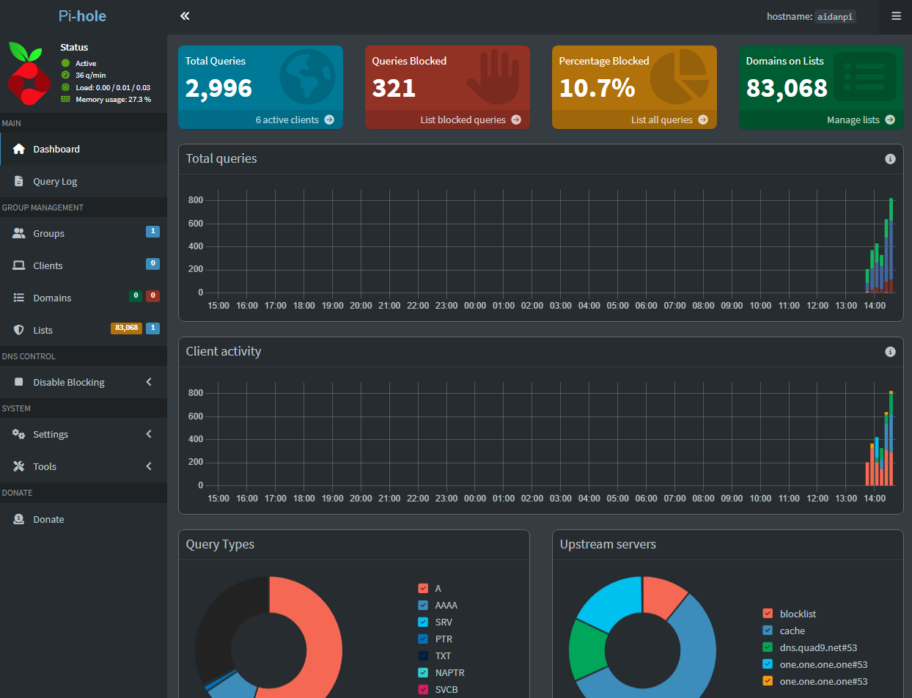

## The pi hole dashboard is really nice looking
I bought my Raspberry Pi 3 around 2016 with the intent on using it for projects. That clearly never really came to fruition. That was more because I could never decide what I wanted to do
with it and a lot of the projects I looked up typically involved buying more parts and add-ons. As a poor Uni student I couldn't justify spending more on something I didn't fully understand.
\
So for the longest time it just sat there doing nothing, occasionally playing about with it to refresh my memory on Linux. Well I say nothing, I mean I didn't do any projects that I could
say I was the main architect of. I set up some NAS with an external HDD I had knocking about.
I did at one point set up my Plex media server to run using the Pi, that way I could just chuck is in a corner and forget about it. Turns out that doesn't work as well as I thought it would
due to transcoding/re-encoding making it run like a slug.
\
\
So what could I do with it? Yeah there were a plethora of things you could technically do with it, but my main issue always came back round to "why would I do this?".
\
I could use Sonarr and Radarr for torrents to download media, but if Plex doesn't work then that's pointless. I could use it as a Personal Cloud but most companies offered more than enough
cloud based storage without having to buy more. I could do the route of RetroPie, but I already have a gaming PC that can emulate better than a Pi.
\
And I understand that for a lot of people the act of actually doing these is the fun, it's a good way to learn and expand your knowledge, and don't get me wrong there is an element to that.
But I struggle to justify taking the time to do these things if they're not giving me some form of output. Why go down the RetroPie route when I could spend that time doing something else
that I might actually use.
\
\
Now I get that by doing this I ended up doing basically nothing with it which in turn defeated the point of owning the damn thing. I get that, which is why I kept coming back and trying something.
But today I have finally seen the light. How I hadn't heard about Pi Hole before I don't know, but it's the first real project I have done using the Pi where I am now getting results. Pi Hole
is a software that acts as a network wide ad blocker and DNS sinkhole, and it's glorious. Typically I have steered away from anything to do with networking,
I would see DNS or DHCP and just check out. I don't find that stuff fun or interesting in the slightest.
\
\
But when I heard about Pi Hole I was right in there. That is the kind of thing I am talking about where I want some form of output, something I can point to and say "this is useful and I am
getting something out of this", and I did. It was easy to set up, I learnt a thing or two about DNS and home networks, and now I get vastly fewer adverts. Honestly couldn't recommend it enough.
\
\
The next step is to go back to that Plex server and get that up and running, I've recently found out that you can in some way bypass the transcoding issue either with direct play
or with changing the film formats, which I could do using Radarr to replace all my current films with .mp4 or .mkv files. This is just a stop gap though, I have an old gaming PC that would
work great as my own personal server for this since it could transcode by itself which could mean I don't need to worry about direct play or files. It also has all my old HDDs which whilst
not fast, it is about 5-6TBs of storage which would be perfect.
\
Having said that though Plex doesn't let you stream to devices outside your home network without a Plex Pass which is £190 for a lifetime pass. So I might be changing over the JellyFin
when I do set that up, so maybe this is all a waste. I guess we shall see.
\
\
I know in the last blogpost I said that the projects section will remain scarce until I finally make myself finish this, and I've technically already broken that promise by setting up Pi Hole
and Plex again, but they're not really things I have done. I haven't made Plex or Pi Hole, they're just services I am using. So *technically* it doesn't count, right?

